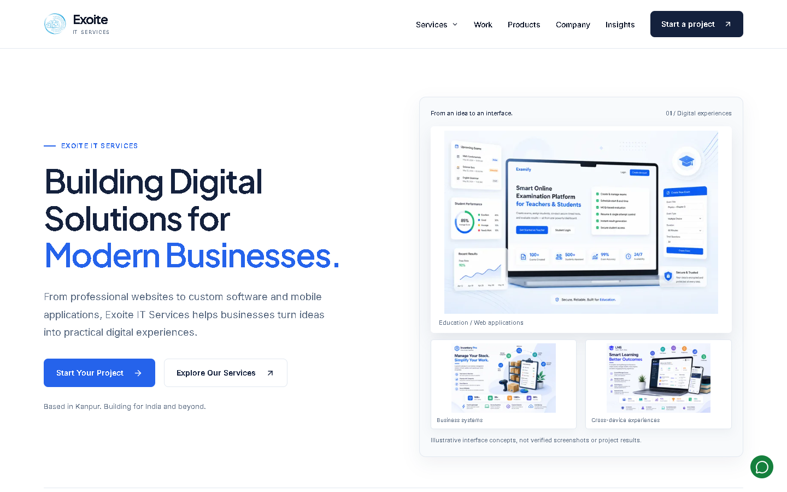

# Exoite — final premium website review

Reviewed 17 November 2026 (Asia/Kolkata). Phase 4 only. **Ready for owner review. No confirmed technical blocker remains in the tested local release candidate.** Eventual release remains subject to owner/content approval and verification of the authorized deployment. Nothing was pushed or deployed.

## Scope and evidence

The production build was served at `http://127.0.0.1:4173` and actually rendered using installed **Chrome 157.0.8103.79**, controlled by **Playwright 1.65.1**, with **axe-core Playwright 4.14.0**. Every one of the **26 content routes** was rendered at **360, 390, 768, 1024, 1440 and 1920 CSS pixels**, with a 900px viewport height and DPR 1: **156 successful route/width checks and full-page screenshots**. Touch checks additionally used emulated mobile contexts.

The eight requested pages received section-by-section DOM measurements at all six widths: 48 page reviews covering **47 main sections plus eight footer regions** per width. All 32 comparison sheets were visually inspected at 390px and 1440px, covering each major section rather than only the first viewport. The areas affected by refinements were inspected again after the change. Other routes received browser rendering, full-page captures, layout/image/SEO checks and axe automation; this does not imply manual pixel-by-pixel inspection of all 156 images.

- [Screenshot gallery: all routes and six widths](../artifacts/final-premium-review/screenshots.html)
- [Final route, image, metadata and axe results](../artifacts/final-premium-review/browser-results.json)
- [Section measurements at all six widths](../artifacts/final-premium-review/section-review.json)
- [Before-refinement section measurements](../artifacts/final-premium-review/section-review-before.json)

| Requested page | 390px full page | 1440px full page | Section comparison sheets |
| --- | --- | --- | --- |
| Homepage | [Mobile](../artifacts/final-premium-review/home-390.png) | [Desktop](../artifacts/final-premium-review/home-1440.png) | 8 sheets; hero, trust, services, AI, work, industries, company, product, process, FAQ, articles, CTA, footer |
| Services | [Mobile](../artifacts/final-premium-review/services-390.png) | [Desktop](../artifacts/final-premium-review/services-1440.png) | 5 sheets; hero, six services, AI category, process, CTA, footer |
| AI Automation | [Mobile](../artifacts/final-premium-review/services--ai-automation-390.png) | [Desktop](../artifacts/final-premium-review/services--ai-automation-1440.png) | 5 sheets; hero, challenges, use cases, deliverables, process, integrations, privacy, related services, FAQ, enquiry, footer |
| Portfolio | [Mobile](../artifacts/final-premium-review/portfolio-390.png) | [Desktop](../artifacts/final-premium-review/portfolio-1440.png) | 3 sheets; hero, all three studies, CTA, footer |
| Products | [Mobile](../artifacts/final-premium-review/products-390.png) | [Desktop](../artifacts/final-premium-review/products-1440.png) | 2 sheets; hero, interactive preview, eight product directions, explanation, footer |
| About | [Mobile](../artifacts/final-premium-review/about-390.png) | [Desktop](../artifacts/final-premium-review/about-1440.png) | 4 sheets; hero, introduction/image, mission/vision, values, technologies, process, CTA, footer |
| Training | [Mobile](../artifacts/final-premium-review/training-390.png) | [Desktop](../artifacts/final-premium-review/training-1440.png) | 3 sheets; hero, all six programs, institution/team enquiry, CTA, footer |
| Contact | [Mobile](../artifacts/final-premium-review/contact-390.png) | [Desktop](../artifacts/final-premium-review/contact-1440.png) | 2 sheets; hero, entire form/sidebar, footer |

The gallery links every section sheet and the other four widths. Gray space between comparison tiles belongs to the review sheet, not the website. Original full-page captures remain available at their native widths.

## Issues found and fixed

1. **Small standalone secondary-link targets.** Secondary enquiries, full-size illustration links, the industry introduction link and Contact email/phone links had approximately 20–23px target heights; AI category secondary links were 32px. Shared rules now give these standalone links a minimum 44px height and centered content. Font sizes, labels, destinations and visual hierarchy remain intact. Inline prose links remain inline. **138 browser assertions** verify target size, focusability, viewport bounds and retained destinations across six widths.
2. **Unsupported homepage service-rail naming.** Axe's manual-review output identified `aria-label` on a generic `div`. The rail now uses native `<nav aria-label="Our core services">` semantics. This removes the semantic review flag without altering layout or adding an unnecessary ARIA role.
3. **Illustration text contrast over an accent shape.** The second decorative product poster used brown `#713d2a`, measuring **4.21:1** against its darker accent. It now uses `#633322`, measuring **4.99:1** against that accent and **7.91:1** against the flat background. The artwork and shared navy/white/blue system remain consistent.
4. **AI test synchronization.** The AI browser suite read the destination heading immediately after SPA URL navigation, before React committed the view. Four assertions raced in one run. The test now explicitly waits for the exact destination heading. Its final **102/102** checks pass. The initial result is retained as `ai-flows-before-wait-fix.json`; no application behavior was changed for this test correction.

Section inspection found no remaining clipped reading text, horizontal page overflow, broken images, destructive image cropping, header collisions or primary-service height inconsistencies at the requested widths. Containers stay bounded on wide desktops; mobile sections stack coherently. Alternating white, gray, blue and navy areas preserve distinct section transitions. Naturally different editorial content lengths were retained rather than forcing arbitrary equal heights everywhere. No redesign, new service, new production dependency or major feature was introduced.

## Verification results

| Check | Actual final result | Evidence |
| --- | --- | --- |
| Production build and prerender | PASS; all 26 routes plus `/404` generated | [Build log](../artifacts/final-premium-review/build.log) |
| Lint | PASS, exit 0 | [Lint log](../artifacts/final-premium-review/lint.log) |
| Complete automated test suite | **80/80 PASS**, zero skipped/failed | [Test log](../artifacts/final-premium-review/tests.log) |
| Browser route matrix | **156/156 PASS**; correct status, canonical, robots, one H1, fonts/images and no document overflow | [Matrix](../artifacts/final-premium-review/browser-results.json) |
| Axe WCAG 2/2.1/2.2 A/AA tags | **Zero violations** across the matrix; manual review described below | [Matrix](../artifacts/final-premium-review/browser-results.json) |
| Responsive layout/navigation | **60/60 PASS** across all six widths | [Results](../artifacts/final-premium-review/layout-navigation.json) |
| Enlarged targets | **138/138 PASS** | [Results](../artifacts/final-premium-review/refinement-regressions.json) |
| Previously fixed production blockers | **132/132 PASS** across six widths | [Privacy/names/contrast/overlap](../artifacts/final-premium-review/blocker-regressions.json) |
| Hover, focus, scroll and touch polish | **41/41 PASS**, including reduced motion and no-JS content | [Results](../artifacts/final-premium-review/interaction-results.json) |
| AI navigation, FAQ and enquiry flows | **102/102 PASS**, 24 intercepted POSTs | [Results](../artifacts/final-premium-review/ai-flows.json) |
| General interactions/contact/provider errors | **36/36 PASS** | [Results](../artifacts/final-premium-review/existing-interactions.json) |
| Hydrated head metadata | **26/26 PASS**; single correct title, description, canonical, robots and JSON-LD | [Results](../artifacts/final-premium-review/hydrated-metadata.json) |
| Illustration contrast | **9/9 text samples PASS** on every evaluated flat layer | [Computed colors](../artifacts/final-premium-review/illustration-contrast.json) |
| SEO HTML, sitemap, internal links/assets/fragments | PASS in automated suite; 24 indexable routes, two noindex legal drafts | [Tests](../artifacts/final-premium-review/tests.log) |
| Vercel output routes | PASS static configuration checks; exact prerendered targets and real status-404 fallback configured | [Tests](../artifacts/final-premium-review/tests.log) |
| Working-tree whitespace | `git diff --check` PASS; only normal Windows line-ending notices | No whitespace errors |

All six widths returned 26/26 successful local route renders. The final matrix recorded **zero console errors** and **zero unresolved request failures**. It retained **one** raw `net::ERR_ABORTED` responsive image-candidate cancellation at 768px on IT Training. All displayed images decoded; the cancelled 640px WebP separately returned HTTP 200, 45,094 bytes, and passed a complete pixel decode. The raw event and validator evidence remain in the matrix; it was not silently discarded.

An initial matrix attempt ran after the preview process had stopped and returned connection refusals. The server was restarted, and all subsequent completed matrices passed. This setup failure is not counted as successful visual testing.

## Interactions, accessibility and preserved protections

Keyboard checks cover the first-focus skip link and main-content target, native disclosure/FAQ controls, Services dropdown, mobile menu Escape/outside-click behavior and focus restoration. Product Calendar/Content controls work by keyboard and touch. Hover tests verify small transform movements, short durations, image containment and clear focus outlines. Scroll reveals cancel when focus enters, do not hide content without JavaScript, clean up across routes and honor changes to reduced-motion preference. Reduced motion removes the tested hover/reveal motion and smooth scrolling.

The contact form still uses POST with a disabled prerendered fieldset until JavaScript initializes, an accessible no-JavaScript explanation and direct contact alternatives. Six-width browser tests cover normal no-JS submission, forced native submission and simulated enabled controls: **no personal information is placed in URL query parameters**. Native/application validation, honeypot rejection, loading state, duplicate protection, success reset and retained data on HTTP/provider/malformed/network failures pass. All ten service enquiry paths retain correct preselection.

All six Training enquiry links retain visible text in their native accessible names, program context, native link semantics and Tab/Shift+Tab access; no overriding aria-label was reintroduced. Contact has no floating WhatsApp button at any tested width, and inline WhatsApp access retains a comfortable target. Mobile floating controls remain hidden. No tested input, label or submit control is obscured.

Shared computed color-token contrast measured:

| Foreground/background | Ratio |
| --- | ---: |
| Muted / white | 5.12:1 |
| Muted / light gray | 4.90:1 |
| White / navy | 15.97:1 |
| White / blue | 5.17:1 |
| Blue / light gray | 4.94:1 |

The complete unit suite also checks dark-muted/navy and the other approved text pairings. Axe checks rendered text on all routes, including headings, labels, footer and AI sections.

Axe retains **14 rule/scan manual-review entries**, all `color-contrast`, for layered poster text and SVG editorial artwork; there are no remaining `aria-prohibited-attr` entries. These are not reported as automated passes. [Full manual-review output](../artifacts/final-premium-review/axe-manual-review.json) is retained. The artwork was visually inspected and its computed text/background/accent colors separately checked: poster minimum **4.99:1**, editorial SVG minimum **14.35:1**. Decorative poster art remains hidden from assistive technology; editorial images have descriptive accessible names. This is targeted automated and semantic QA, not full WCAG certification or a manual screen-reader session. Inline prose links and spaced breadcrumbs are not claimed to be 44px buttons.

All Web3Forms submissions and WhatsApp handoffs during automation were intercepted. **No real enquiry or WhatsApp message was sent**, and inbox delivery/account behavior was not tested.

## Domain redirects and Vercel

Read-only HTTPS requests with redirects explicitly disabled at each hop verified the actual public chain:

| Public path | Apex domain | `www` domain |
| --- | --- | --- |
| `/` | 200, no redirect | 308 to same apex path, then 200 |
| `/contact` | 200, no redirect | 308 to same apex path, then 200 |
| `/services/ai-automation` | 404, no redirect | 308 to same apex path, then 404 |

[Recorded response chain](../artifacts/final-premium-review/public-domain-redirects.json). **No redirect loop occurred in these direct requests.** An earlier web-fetch service reported a loop, but direct Node HTTPS requests contradicted that result; the direct status/Location chain is the evidence used here. Windows curl's Schannel credential error also prevented curl from serving as evidence.

The existing canonical origin remains `https://exoiteitservices.com`. `vercel.json` was preserved during Phase 4: the current www-to-apex behavior agrees with the directly observed public chain. No application-level host redirect was added. All 26 configured route destinations exist after prerendering; sitemap and canonical checks pass. The configured 404 status is checked statically; Vite preview's SPA fallback does not emulate Vercel's full routing, headers, caching or custom-domain configuration.

The public AI route currently returns 404, so the live deployment is not this local Phase 2–4 release candidate. Owner approval and an authorized deployment are required before those new URLs can work publicly. No Vercel account/dashboard settings were inspected or modified; platform routing for this newly built candidate still needs a deployment-level smoke test. The existing public homepage/Contact redirect behavior was verified read-only, not changed.

## Performance and imagery

Final build output: JavaScript **404.45kB / 124.00kB gzip**, CSS **78.57kB / 15.49kB gzip**. No animation library or production package change was added in this phase. Images retain responsive WebP candidates, intrinsic dimensions/reserved frames, appropriate contain behavior for interface art and lazy loading below the hero. The primary hero image remains high priority. Both local font faces load at all six tested widths, and the fresh homepage delivery probes recorded no external resource requests. [Image/font probe](../artifacts/final-premium-review/image-font-delivery.json).

The sampled local homepage interaction run measured a non-input layout-shift sum of **0**. This is a local observation, not field Core Web Vitals or a throttled mobile/Lighthouse score. Real-world LCP/INP, CDN latency and device performance remain unmeasured. The Phase 3 asset inventory remains applicable; this phase introduced no image assets.

Owner-supplied assets still required to present genuine work: approved application screenshots for Examify, Inventory and LMS, verified project facts/permissions, genuine company/team imagery, and real product screenshots once a releasable application exists. Current previews and workspace/training visuals remain explicitly illustrative; no completed AI client project or released-product claim was added. The asset gap does not block review of the clearly labelled concept presentation, but those concepts must not be relabelled as completed work without evidence.

## Files changed in Phase 4

- `src/styles/interactions.css`: standalone link targets.
- `src/styles/sections.css`: poster text color.
- `src/components/sections/Hero.jsx`: native service navigation semantics.
- `scripts/ai-services.browser.mjs`: explicit destination-heading wait.
- `scripts/final-refinements.browser.mjs`: computed target/focus/bounds regression checks.
- `scripts/illustration-contrast.browser.mjs`: actual illustration color/layer contrast regression checks.
- This report and `artifacts/final-premium-review/`: screenshots, comparison sheets, JSON results, command logs and archived QA sources. Existing Phase 1–3 worktree changes were retained.

## Repeating checks and release decision

Run `npm.cmd run build`, `npm.cmd run lint` and `npm.cmd test`. For browser checks, install Playwright 1.65.1 and @axe-core/playwright 4.14.0 in an isolated `.qa-tools` directory, start `npm.cmd run preview -- --host 127.0.0.1 --port 4173`, and run the two new scripts plus existing interaction/AI suites. The exact six-width QA variants and section-sheet generator are archived in [automation-source](../artifacts/final-premium-review/automation-source/); restore the desired `.mjs.txt` file to `.qa-tools` with the `.txt` suffix removed, then run Node against it. The archived variants write to this phase's artifact directory. A generated screenshot index provides navigable evidence without requiring the QA dependencies.

The owned preview server was stopped and the temporary `.qa-tools` installation was removed after verification. Screenshots, archived QA sources and result files remain available. All report evidence links and all 156 route screenshot files were checked successfully.

**Owner review: ready. Local tested technical blockers: none. Unconditional production sign-off: pending.** Before an eventual authorized release, the owner must approve the content and draft Privacy Policy/Terms, and deployment-level checks must verify new routes, real 404 responses, canonical host, security/cache headers and the domain redirect chain on the actual candidate. Actual delivery/inbox receipt needs a controlled owner-approved enquiry test. Safari/Firefox, physical mobile devices, real screen-reader usability and real WhatsApp application behavior were not verified here. No push, deployment, domain-setting change or real enquiry was performed.
