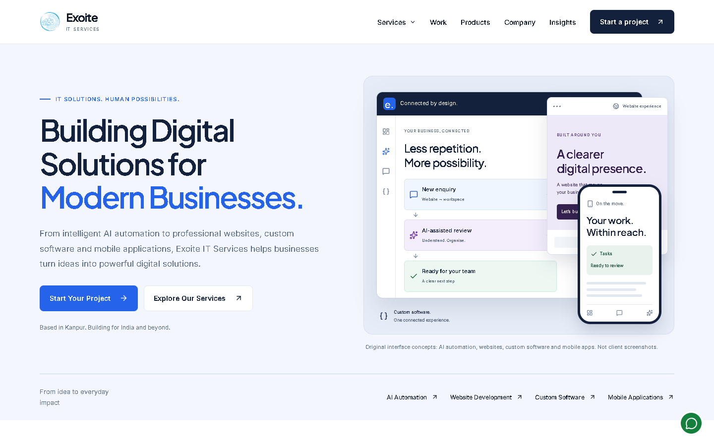

# Premium homepage transformation — audit and implementation

## Before changing components

Audit performed 17 November 2026. The existing production build was rendered locally in Chrome at 390px and 1440px; full-page screenshots and representative upper/middle/lower crops were captured and visually inspected. [Before screenshots](../artifacts/homepage-premium/before/).

Observed issues:

- The hero repeats the same three promotional concept images used later in the portfolio. Examify dominates the first impression, while AI automation is absent from the supporting copy and capability rail.
- The company introduction appears after industries, rather than establishing the company immediately after the hero. Upcoming products precede the process section; the chapter sequence does not follow the requested visitor journey.
- Three equally weighted service boxes make the service offering feel generic. Their long text and actions leave tall, visually empty card areas on mobile. AI sits outside the primary capabilities.
- The AI visual is a static four-box pipeline. It describes a workflow but provides no way to inspect what happens at each stage.
- The portfolio gives one concept a large treatment and two much smaller treatments; the latter's embedded interface details are difficult to read. The hero has already shown all three images.
- Most chapter headings repeat the same split heading/description/CTA composition. There is too little contrast in composition between services, work, process and other editorial sections.
- The page measures 16,307px tall at 390px and 10,086px at 1440px, including navigation/footer. Separate trust and FAQ chapters add length; the mobile hero montage is especially tall.
- The illustrations contain tiny baked-in interface text and promotional figures; existing concept disclaimers are necessary and must stay. Genuine project screenshots have not been supplied.

The baseline has readable shared text, usable navigation, no observed page overflow in these screenshots, and intentional white/navy/blue/gray surfaces. This is a design-direction change, not a claim that the previously verified site was functionally broken.

## Intended direction

Ten coordinated chapters: hero, company introduction, four core services, AI feature, featured software concepts, industries, process, upcoming product, insights and final enquiry. Consolidate the trust facts into the introduction and keep existing FAQ answers within the process chapter. Use an original code-native software composition in the hero, an interactive example workflow, editorial service rows and large project visuals. Retain the current brand colors and typography, and scope new styling to the homepage. Preserve all 26 current URLs, existing enquiry integrations, SEO/prerendering and hosting configuration.

The completed changes and verification evidence follow.

## Completed transformation

The homepage now follows the ten requested chapters. The existing 26-route application, shared header/footer, enquiry system and hosting configuration remain in place. This task added no service routes or production dependencies.

1. **Hero.** The requested headline, supporting text and two CTA labels are implemented. A new original HTML/CSS interface composition shows an AI-assisted workflow, website, custom workspace and mobile application. It replaces the repeated Examify/Inventory/LMS hero montage and is explicitly labelled as concept artwork. The visual renders in initial HTML, scales proportionally with its container and requires no raster download, canvas or WebGL. Essential service descriptions remain readable page text outside the decorative artwork.
2. **Company introduction.** Moved immediately after the hero. A concise statement and four factual indicators replace the separate trust chapter and late company introduction. No client logos, testimonials or experience statistics were invented.
3. **Core services.** AI Automation, Website Development, Custom Software and Mobile Applications use four editorial rows with distinct original capability illustrations, supporting text and service links. School/institute solutions, digital marketing and training remain directly discoverable. The previous three equal boxes are gone.
4. **AI feature.** A navy chapter carries the exact requested headline/description, five example capabilities and a white CTA to the existing `/services/ai-automation` page. Visitors can select four workflow stages by keyboard or touch, advance with Next step and restart the example. The explanation changes to show capture, AI categorization, a proposed CRM record and a human-reviewed follow-up suggestion. The demo has no live integration, data collection or sending behavior. Labels and stage notes make this explicit.
5. **Featured software projects.** Examify, Inventory and LMS receive large alternating editorial presentations. Images remain contained inside reserved 16:10 frames with subtle hover zoom. Concept/screenshot distinctions, full-size links, project enquiry context and solution-study routes are preserved. The existing `project.visual` data hook still supports genuine replacement screenshots when supplied.
6. **Industries.** Existing accessible disclosures remain, with a distinct pale-blue background and white education feature. Tablet composition differs from desktop and mobile without hiding information behind hover.
7. **How we work.** The six existing process stages sit above the five retained FAQ answers within one chapter. `Process` and `FAQ` accept an optional embedded presentation; their default internal-page presentation is unchanged.
8. **Upcoming products.** The existing interactive Calendar/Content preview remains in its proper place after process. In-development and illustrative-interface disclosures remain visible; no release or integration availability is promised.
9. **Insights.** The original editorial artwork and articles remain, with coordinated spacing, a substantial lead story and two secondary reading links.
10. **Project enquiry.** The final navy CTA retains the existing Contact, email and WhatsApp destinations.

New CSS is scoped to `.homepage`. Existing shared button feedback, navigation hover feedback, visible focus outlines, portfolio hover behavior and efficient one-time section reveals are retained. New service rows lift 3px over 220ms; hero layers move 3–4px on hover without continuous floating. New transitions and transforms honor reduced-motion preference. Native keyboard controls, visible content before hydration and a no-JavaScript workflow explanation are preserved. Although the brief mentioned Framer Motion, the actual checkout has no such dependency; the existing IntersectionObserver/Web Animations system and CSS provide the requested effects without adding a library.

## Screenshots and responsive review

[Open the before/after screenshot gallery](../artifacts/homepage-premium/screenshots.html). It includes all six homepage widths, workflow-state captures, seven desktop/mobile section comparison sheets and the route regression screenshots.

| Width | Hero viewport | Entire homepage | Final workflow step |
| --- | --- | --- | --- |
| 360px | [Hero](../artifacts/homepage-premium/hero-360.png) | [Full page](../artifacts/homepage-premium/home-360.png) | [Example](../artifacts/homepage-premium/workflow-last-step-360.png) |
| 390px | [Hero](../artifacts/homepage-premium/hero-390.png) | [Full page](../artifacts/homepage-premium/home-390.png) | [Example](../artifacts/homepage-premium/workflow-last-step-390.png) |
| 768px | [Hero](../artifacts/homepage-premium/hero-768.png) | [Full page](../artifacts/homepage-premium/home-768.png) | [Example](../artifacts/homepage-premium/workflow-last-step-768.png) |
| 1024px | [Hero](../artifacts/homepage-premium/hero-1024.png) | [Full page](../artifacts/homepage-premium/home-1024.png) | [Example](../artifacts/homepage-premium/workflow-last-step-1024.png) |
| 1440px | [Hero](../artifacts/homepage-premium/hero-1440.png) | [Full page](../artifacts/homepage-premium/home-1440.png) | [Example](../artifacts/homepage-premium/workflow-last-step-1440.png) |
| 1920px | [Hero](../artifacts/homepage-premium/hero-1920.png) | [Full page](../artifacts/homepage-premium/home-1920.png) | [Example](../artifacts/homepage-premium/workflow-last-step-1920.png) |

Chrome actually rendered these captures. Manual visual inspection covered all ten homepage chapters using the seven comparison sheets at 390px/1440px, plus hero views at 360px, 768px, 1024px and 1920px and the tablet service layouts. Automated composition measurements covered all six widths. Gray gutters between comparison tiles are part of the review sheet, not the page.

The container remains bounded at 1280px on wide screens. The hero uses two columns on desktop and stacks below 950px. Service rows use three columns on desktop, two on tablet and a title/thumbnail plus full-width description on mobile. Buttons stack on narrow screens. Project artwork reserves space and keeps its full content visible. Workflow height remains unchanged across all four states at every tested width. No clipped reading text, page overflow or undersized standalone main-content target was found in the final six-width section measurements.

The 390px page is 15,655px tall versus 16,307px before; the 1440px page is 10,012px versus 10,086px before, including the unchanged shared header/footer. The transformation improves hierarchy and chapter composition rather than relying on a claim of dramatically reduced page length. The larger project artwork and interactive AI feature remain substantive content.

## Actual verification results

Tested against the production build on local Vite preview, using **Chrome 157.0.8103.79**, **Playwright 1.65.1** and **@axe-core/playwright 4.14.0**.

| Verification | Result | Evidence |
| --- | --- | --- |
| Production build/prerender | PASS: 26 content routes plus `/404` | [Build log](../artifacts/homepage-premium/build.log) |
| Lint | PASS, exit 0 | [Lint log](../artifacts/homepage-premium/lint.log) |
| Complete automated test suite | **80/80 PASS**, no skipped tests | [Tests](../artifacts/homepage-premium/tests.log) |
| Six-width browser route matrix | **156/156 PASS** | [Route/layout/axe results](../artifacts/homepage-premium/browser-results.json) |
| Homepage-specific behavior/composition | **87/87 PASS** | [Homepage checks](../artifacts/homepage-premium/homepage-checks.json) |
| Interactive workflow accessibility | **24 state/width axe scans, zero violations** | [Homepage checks](../artifacts/homepage-premium/homepage-checks.json) |
| Hover/focus/scroll/touch/reduced motion | **41/41 PASS** | [Interaction checks](../artifacts/homepage-premium/interaction-results.json) |
| Layout/header/mobile navigation | **60/60 PASS** | [Layout/navigation](../artifacts/homepage-premium/layout-navigation.json) |
| Existing four-blocker regressions | **132/132 PASS** | [Privacy, names, contrast, overlap](../artifacts/homepage-premium/blocker-regressions.json) |
| Existing AI navigation/enquiries | **102/102 PASS**, 24 intercepted test POSTs | [AI flows](../artifacts/homepage-premium/ai-flows.json) |
| General contact and interaction flows | **36/36 PASS** | [Existing interactions](../artifacts/homepage-premium/existing-interactions.json) |
| Hydrated SEO metadata | **26/26 PASS** | [Metadata](../artifacts/homepage-premium/hydrated-metadata.json) |
| New hero computed contrast | **23 samples, minimum 4.76:1** against their painted background layers | [Computed colors](../artifacts/homepage-premium/hero-computed-contrast.json) |
| Retained poster/editorial artwork contrast | **9/9 samples PASS** | [Illustration colors](../artifacts/homepage-premium/illustration-contrast.json) |
| Six-width section measurements | No clipped reading text or undersized standalone main target | [Section review](../artifacts/homepage-premium/section-review.json) |
| Whitespace | `git diff --check` PASS | Normal Windows line-ending notices only |

The route matrix reports zero console errors, zero axe violations and zero unresolved request failures. **Seven raw responsive WebP request cancellations** were recorded while Chrome changed image candidates. All displayed images decoded successfully; fresh requests to the three affected asset URLs returned HTTP 200 and passed complete pixel decoding. The raw events and separate validation evidence remain in the matrix.

Axe retains **14 rule/scan manual-review entries**, all involving contrast/background determination in layered illustrations or compact product preview art. These are not counted as automated passes. [Full review output](../artifacts/homepage-premium/axe-manual-review.json) is retained. The artwork was visually inspected and actual flat-layer colors separately checked, including the new hero. This does not constitute full WCAG certification or a manual screen-reader usability audit.

The first scan found a new hero artwork caption at 4.35:1 on its pale-blue background. Its foreground was darkened, and the final minimum measured ratio is 4.76:1. No contrast threshold was relaxed. Initial results are retained as `browser-results-before-contrast-fix.json`. The first focused test also exposed a heading-read synchronization race after SPA navigation and a Playwright text selector that did not reliably select rendered noscript content; explicit destination-heading waiting and direct noscript paragraph targeting now pass. The underlying no-JavaScript explanation was verified rendered.

## Functionality and technical preservation

All 26 existing URLs, metadata, canonical URLs, JSON-LD and prerendered content are checked. The sitemap continues to include 24 indexable routes; the two existing legal drafts remain noindex. Existing internal links, fragments, image assets and all configured Vercel route targets pass the automated suite. Homepage tests were updated to check the new four-service composition and original code-native hero rather than the superseded three-card/raster-montage implementation.

The contact form, submission logic, credentials/configuration and privacy protections were not changed. Six-width tests verify disabled no-JavaScript controls, explicit POST fallback and no personal-data URL leakage. Native/application validation, duplicate prevention, honeypot rejection, success handling, provider/network failures and retained form data pass. Service and project preselection remain intact. Training link names and keyboard semantics remain intact. Contact has no floating WhatsApp obstruction; the existing inline WhatsApp paths remain available. Automated contact and WhatsApp handoffs were intercepted: **no real enquiries or messages were sent**.

`vercel.json`, domain redirect rules, canonical host, route inventory, root package manifest and lockfile were not modified during this homepage task. No application-level www/non-www redirect was introduced. Vercel compatibility was checked through the existing build-output/configuration regressions; this new candidate was not deployed, and Vite preview is not a simulation of deployed Vercel headers/CDN/routing behavior.

React review: the new interactive component has one local state value and stable `useId` control association; the workflow data is static and outside the component. No timers, background requests, effects for derived state, client secrets, new animation library or unnecessary global event listeners were added. The existing reveal hook remains responsible for efficient section observation, route cleanup, focus cancellation and motion preferences.

## Performance and assets

Final build output is **413.59kB JavaScript / 126.30kB gzip** and **106.11kB CSS / 19.89kB gzip**. Compared with Phase 4, this is approximately **2.30kB additional gzipped JavaScript** and **4.40kB additional gzipped CSS**. No production dependency was added. The new hero has no external or raster resource dependency; existing responsive WebP portfolio assets load below the fold. Local font faces loaded at all six widths with no external resource requests in fresh homepage probes. [Composition/font observations](../artifacts/homepage-premium/composition.json).

The sampled local interaction run recorded a non-input layout-shift sum of **0**. This is not a Lighthouse result or a field Core Web Vitals measurement. Physical-device performance, production CDN latency and real-world LCP/INP were not measured.

All new hero/service artwork is original code-native UI, not copied third-party imagery or a completed customer implementation. Existing concept assets are reused only where appropriate. Genuine owner-approved project screenshots, verified case-study facts and a real released-product capture remain outstanding assets. The existing project-image data system supports their later inclusion; this phase did not fabricate them.

## Files changed for this task

- `src/pages/Home.jsx`: ten-chapter composition and homepage scope.
- `src/components/sections/Hero.jsx`, `CompanyIntro.jsx`, `Services.jsx`, `AIAutomationFeature.jsx`: hero, early company introduction, four-service editorial layout and major AI feature.
- `src/components/ui/DigitalStudioVisual.jsx`, `WorkflowDemo.jsx`: original software artwork and inspectable example workflow.
- `src/components/sections/HomeProcess.jsx`, `Process.jsx`, `FAQ.jsx`: combined process/FAQ chapter with default internal-page behavior preserved.
- `FeaturedSolutions.jsx`, `Industries.jsx`, `ProductShowcase.jsx`, `InsightsPreview.jsx`: homepage chapter labels and presentation coordination. Detailed internal portfolio headings remain unaffected.
- `src/styles/homepage.css`, `src/index.css`: scoped responsive presentation and motion preferences.
- `scripts/homepage-premium.browser.mjs`: focused homepage/interactive-state browser regression suite.
- `scripts/site.test.mjs`, `ai-services.test.mjs`, `interaction-polish.browser.mjs`, `ui-ux-phase1.browser.mjs`: assertions/selectors updated to the new intentional homepage structure while retaining coverage.
- This report and `artifacts/homepage-premium/`: before/after captures, comparison sheets, test evidence and archived QA sources. Prior-phase worktree changes were preserved.

To reproduce: run build, lint and tests; install isolated Playwright/axe QA dependencies in `.qa-tools`; start the production preview on port 4173; run `node scripts/homepage-premium.browser.mjs`. The exact six-width route and regression variants are preserved under [automation-source](../artifacts/homepage-premium/automation-source/), alongside the screenshot-sheet generator.

All report links and all 156 route screenshot files were verified present. The owned preview server was stopped and temporary `.qa-tools` installation removed; archived sources and evidence remain available.

**Homepage transformation complete and ready for owner review.** No confirmed blocker remains in the tested local scope. Cross-browser testing beyond Chrome, physical mobile devices, manual assistive-technology sessions, real enquiry delivery and the actual deployed candidate remain unverified. No push, deployment or hosting/domain setting change was performed.

